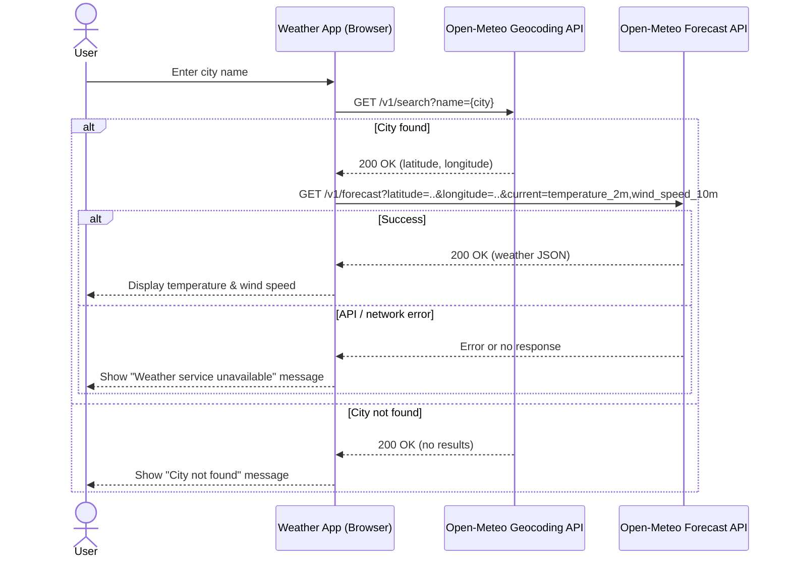

# 🌦️ Weather API App

A browser-based weather app that looks up any city and shows its current weather, built with **spec-driven development**: I wrote the requirements, AI generated the code, and I verified every requirement with traceable tests.

**🔗 Live demo:** https://YOUR-USERNAME.github.io/weather-api-app/

---

## Why I built this

I'm a Solutions Architect with 15+ years in automotive systems engineering (requirements, SysML, ASPICE). This project is part of my learning path into APIs and AI-assisted development. It applies the same discipline I use with engineering teams (requirements → design → verification → traceability), with AI acting as the development team.

---

## How it works

The app uses two free, public APIs from [Open-Meteo](https://open-meteo.com/). Neither needs an API key.

| API | Purpose | Endpoint |
|---|---|---|
| Geocoding API | Converts a city name to latitude/longitude | `https://geocoding-api.open-meteo.com/v1/search` |
| Forecast API | Returns current weather for coordinates | `https://api.open-meteo.com/v1/forecast` |

### Sequence diagram

---

## Requirements

| ID | Requirement |
|---|---|
| REQ-01 | The system shall accept a city name as input. |
| REQ-02 | The system shall convert the city name to coordinates using the Open-Meteo Geocoding API. |
| REQ-03 | The system shall display the current temperature (°C) and wind speed (km/h). |
| REQ-04 | The system shall show a clear message if the city is not found. |
| REQ-05 | The system shall not crash if the network is unavailable, and shall show an error message instead. |
| REQ-06 | The system shall not require or store any API keys or personal data. |
| REQ-07 | The system shall be usable on both desktop and mobile screen sizes. |

---

## Traceability & verification

Each requirement is verified in two ways: a **code review** (static, against the source) and a **live test** (dynamic, on the deployed app).

| Req ID | Implementation (in `index.html`) | Test case | Expected result | Code review | Live test |
|---|---|---|---|---|---|
| REQ-01 | `#cityInput` field, `#searchBtn` button, Enter-key listener; empty input rejected with a message | Enter "Bangalore", press Search and also press Enter; then search with an empty box | Search runs both ways; empty input shows "Please enter a valid city name." | ✅ | ☐ Pass / ☐ Fail |
| REQ-02 | `getWeather()` → fetch to Geocoding API (`count=1`) | Search "Bangalore" | Coordinates retrieved (~12.97, 77.59) and passed to the forecast call | ✅ | ☐ Pass / ☐ Fail |
| REQ-03 | `getWeather()` → fetch to Forecast API (`current=temperature_2m,wind_speed_10m`); values written to `#tempDisplay` and `#windDisplay` | Search "Bangalore" | City name, temperature (°C) and wind speed (km/h) shown | ✅ | ☐ Pass / ☐ Fail |
| REQ-04 | Check for empty `geoData.results` → message in `#messageArea` | Search "Xyzabc123" | "City not found" message, no weather card | ✅ | ☐ Pass / ☐ Fail |
| REQ-05 | `try/catch` around both fetches; `response.ok` checks | Turn Wi-Fi off, then search | Connection error message shown, page keeps working | ✅ | ☐ Pass / ☐ Fail |
| REQ-06 | No keys, tokens or storage in source | Search source for `key`, `token`, `github_pat_`, `localStorage` | Nothing found | ✅ | ☐ Pass / ☐ Fail |
| REQ-07 | `@media (max-width: 480px)` rules; `box-sizing: border-box` | Open on a phone, or narrow the browser window | Input and button stack vertically; no sideways scrolling | ✅ | ☐ Pass / ☐ Fail |

### Known limitations
- **Ambiguous city names:** the geocoding call uses `count=1`, so "Paris" returns Paris, France, not Paris, Texas. A future requirement could let the user choose between matches.
- **Single error message:** every failure (network down, API error, missing data) shows the same "Unable to connect" message. The console log keeps the specific cause for debugging.

---

## Run it yourself

No installation needed:

1. Download `index.html`.
2. Double-click it to open it in any modern browser.

Or use the live demo link above.

---

## Security notes

- No API keys, tokens, or credentials are used or stored. Open-Meteo's free tier doesn't need them.
- No user data is collected or saved.
- In projects that do need keys, they belong in environment variables or a backend, never in frontend code or public repositories.

---

## What I learned

- How REST APIs work: requests, responses, HTTP methods, status codes, and JSON
- How to read API documentation the way I'd read an interface specification
- API authentication basics (tokens, rate limits) and API security (OWASP API Top 10)
- How to direct AI to build to a written spec, and verify the output instead of trusting it blindly

---

## Next improvements

- [ ] Show a loading indicator and disable the Search button while a request is running
- [ ] Let the user choose between cities with the same name
- [ ] Add a 5-day forecast view
- [ ] Remember the last searched city
- [ ] Show weather icons based on conditions
- [ ] Add °C / °F toggle

---

## Built with

- HTML, CSS, JavaScript (single file, no frameworks)
- [Open-Meteo API](https://open-meteo.com/) (free weather data, no key needed)
- AI-assisted development: code generated by AI against my written requirements, then reviewed and tested by me

---

*Part of my API & AI learning journey. Connect with me on [LinkedIn](https://www.linkedin.com/in/aniketjha-38459a17).*
